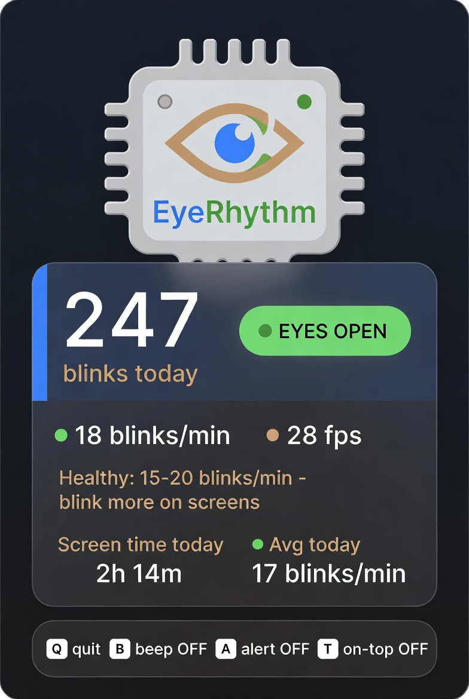

# EyeRhythm — BlinkCounter

**Your eyes work hard for you. EyeRhythm helps them work longer.**

Every day millions of knowledge workers, students and creators spend hours staring at screens. Research from the American Academy of Ophthalmology shows that the spontaneous blink rate drops by **half or more** during computer use. Fewer blinks → dry eyes, fatigue, blurred vision, and the classic symptoms of Computer Vision Syndrome.

EyeRhythm is a lightweight, **completely offline** open-source companion that quietly watches your blink rate through the built-in webcam and gently nudges you back toward a healthy rhythm (~15–20 blinks per minute). No accounts, no cloud, no analytics, no video ever leaves your machine. The camera is used only for *your* benefit — so you can stay focused longer with less strain and build a lifelong habit of regular blinking.

> **Privacy first.** Once installed, EyeRhythm runs 100 % offline. Nothing is uploaded. Nothing is shared. The only data stored is a tiny local JSON file with today’s blink count and screen-time minutes (it resets at midnight).

---

## What you see



The window is a compact **statistics-only** card (the live camera feed is never shown):

| Element | Meaning |
|--------|---------|
| **Large number** | Total blinks counted **today** (survives restarts & app closes) |
| **EYES OPEN / CLOSED** | Live eye state |
| **blinks/min** | Instantaneous rate (colour-coded: green = healthy, amber = low, red = very low) |
| **Screen time today** | How long a face has been in front of the screen |
| **Avg today** | Daily average = total blinks ÷ screen-time minutes |
| **Help bar** | Live status of the keyboard toggles |

---

## Quick start

### macOS / Linux

```bash
# 1. Install Python 3.10–3.12 if you don’t have it
#    → https://www.python.org/downloads/   or   brew install python@3.11

# 2. Clone / open the project, then:
cd EyeRhythm
python3 -m venv EyeRhythm          # venv named exactly “EyeRhythm”
source EyeRhythm/bin/activate
pip install -r requirements.txt

# 3. Run
python -m app.main
# or simply:
./run_mac.sh
```

The first time macOS will ask for **Camera** permission — allow it  
(System Settings → Privacy & Security → Camera).

Detailed step-by-step (including troubleshooting) lives in  
**[`for_mac/`](for_mac/)**.

### Windows

**Option A — for everyone (recommended for non-coders)**  
1. Install Python 3.10–3.12 from [python.org](https://www.python.org/downloads/)  
   ⚠️ **tick “Add python.exe to PATH”** during setup.  
2. Double-click **`run_windows.bat`**.  
   It creates the virtual environment, installs everything and launches the app.  
   That’s it — no extra tools required.

**Option B — from source (coders)**  
See the full end-to-end guide in **[`for_windows/`](for_windows/)**.

You can also build a single-folder standalone executable with the included  
`build_windows.bat` (requires PyInstaller).

---

## Keyboard shortcuts

| Key | Action |
|-----|--------|
| **Q** / **Esc** | Quit |
| **B** | Toggle beep on every counted blink (default OFF) |
| **A** | Toggle low-rate alert (beeps while rate < 10 blinks/min, default OFF) |
| **T** | Toggle always-on-top |

All toggles show their live state in the bottom help bar.

---

## Libraries (all open-source)

- **MediaPipe** (Face Landmarker) — Apache 2.0  
- **OpenCV** — Apache 2.0  
- **NumPy** — BSD  
- **Pillow** — HPND  
- **Inter** typeface — SIL Open Font License 1.1  

The face-landmarker model is bundled under `models/` (Apache 2.0).

---

## Project layout

```
EyeRhythm/
├── app/                 # UI + camera loop
├── blink_core/          # platform-independent blink detection & screen-time
├── models/              # MediaPipe face landmarker
├── assets/              # fonts + logo + screenshot
├── for_mac/             # macOS install & run helpers
├── for_windows/         # Windows install & run helpers
├── tools/               # optional signal-analysis helpers
├── requirements.txt
├── run_app.py           # thin entry point (also used by PyInstaller)
├── run_mac.sh
└── run_windows.bat
```

---

## Feedback & sharing

I have done my best to make blink detection as accurate and robust as possible across different faces, lighting conditions and eyeglasses. Still, real-world conditions vary — if the counter feels off for you, or you have ideas for improvement, please open an issue or drop me a note. Your feedback directly helps make the next version better.

If EyeRhythm is useful, **please share it with friends, family and colleagues**. A simple healthy habit — blinking regularly — is one of the easiest gifts we can give our eyes in the digital age.

Thank you for using EyeRhythm. Take care of your eyes — they are the only pair you get.

---

*EyeRhythm is free and open-source. Use it, improve it, share it.*
